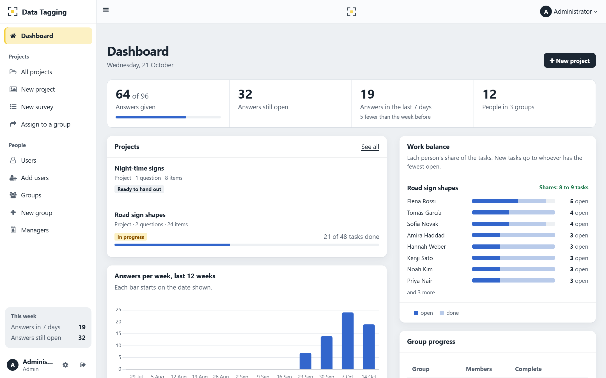
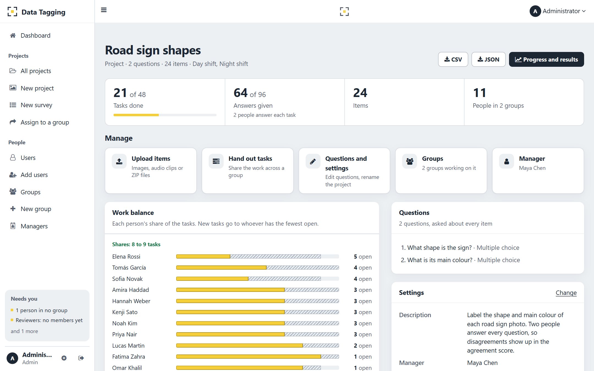
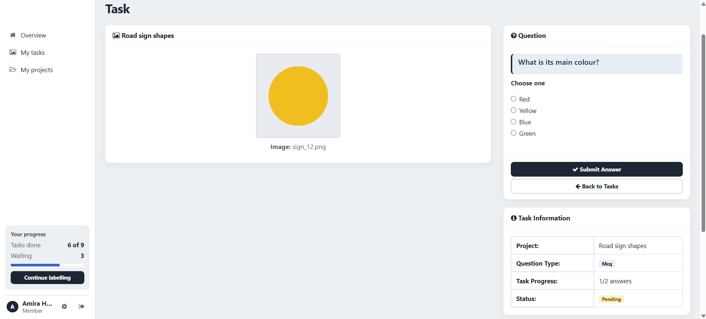
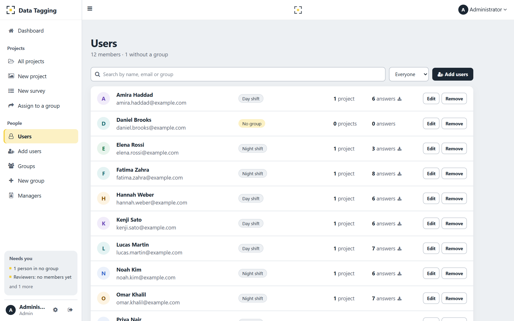
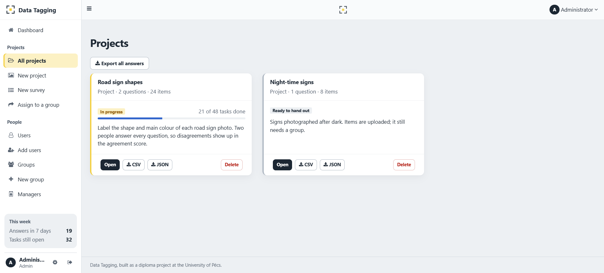

# Data Tagging

[](https://github.com/baselnasser99/Data-Tagging-Application/actions/workflows/tests.yml)


**A web app that shares labelling work fairly across a team.** An admin uploads images or audio clips and writes the questions. The app splits the work into tasks and hands them out so everyone carries the same load, even while people join or leave mid-project. The answers come back as a CSV or JSON dataset, with an agreement score showing how consistently people labelled.

Built as my diploma thesis project, then rebuilt to production standards: security fixes, a fairness algorithm verified with measurements, 200+ automated tests, and a redesigned interface. [See what changed since the graded version →](docs/thesis/COMPARISON.md)



<table>
  <tr>
    <td width="50%"><br><sub><b>Project overview:</b> progress, items, hand-out and settings</sub></td>
    <td width="50%"><br><sub><b>Member's task:</b> one item, one question</sub></td>
  </tr>
  <tr>
    <td><br><sub><b>People:</b> search, groups, edit and remove</sub></td>
    <td><br><sub><b>Projects:</b> status and progress at a glance</sub></td>
  </tr>
</table>

<sub>Screenshots use the demo data from <code>scripts/seed_demo.py</code>.</sub>

---

## What it does

| | |
|---|---|
| **Projects** | Upload images (PNG, JPG, GIF, BMP, WEBP) and audio (MP3, WAV, OGG, M4A, FLAC) as files or ZIPs. Ask free-text or multiple-choice questions about every item. |
| **Fair hand-out** | Every *item × question* becomes a task. Each task goes to the person with the lightest open workload, never twice to the same person, up to a per-person cap. Optionally, several people can answer each task. |
| **People come and go** | When someone leaves a group, their unfinished tasks are handed to the rest; when someone joins, workloads are rebalanced. Finished answers are never lost. |
| **Three roles** | **Admin** (everything), **Manager** (runs their own projects), **Member** (answers their tasks). Each role gets its own home page. |
| **Progress** | Status and progress on every project card, answers per week, progress per group, and a side-panel summary for each role. |
| **Export** | CSV or JSON per project, with who answered what and when, the majority answer, and **Fleiss' kappa** for inter-annotator agreement. Every export is logged. |
| **People admin** | Add people one at a time or from a CSV file, search and filter them, edit details, and remove people safely: their open work is handed on and their answers are kept. |
| **Surveys** | A simpler mode in which every member answers every question. |

## How the hand-out stays fair

```
for each task (item, question) still needing answers:
    candidates = members of the project's groups
                 who don't hold this task yet and are under the per-person cap
    give it to the candidate with the fewest open tasks
        ties → fewest of this question → fewest tasks overall → lowest id
```

- **Someone leaves:** their unfinished tasks are released and handed out again with the same rule; their finished work stays.
- **Someone joins:** open slots are filled first, then unstarted tasks move from the busiest person to the least busy until no move narrows the gap. In the measurements below, loads end within one task of each other.
- **Several groups on one project** share a single pool of tasks.

The code is in [`application/distribution.py`](application/distribution.py), and the rules are pinned down by tests in [`tests/test_distribution.py`](tests/test_distribution.py).

## Measured, not assumed

[`scripts/benchmark.py`](scripts/benchmark.py) builds made-up teams and projects on a **MySQL 8** server in GitHub Actions ([workflow](.github/workflows/benchmark.yml)), then times the real distribution code and checks its fairness.

| Tasks | People | Hand out | 10% of people leave | 5% join | Load gap after joining |
|---:|---:|---:|---:|---:|---:|
| 1,000 | 20 | 0.39 s | 0.08 s | 0.06 s | 1 |
| 10,000 | 50 | 4.55 s | 2.26 s | 1.84 s | 1 |
| 50,000 | 100 | 24.9 s | 15.4 s | 16.9 s | 1 |

- The load gap (most open tasks held by one person minus fewest) is **0** right after hand-out.
- In every run, every task kept an owner and no finished answer was lost.
- Batching the database writes made the hand-out **2.5× faster**, and handling 5% newcomers at 50k tasks **15× faster** (250 s → 17 s).
- **Load test:** 20 people answering at once made 240 requests with **0 errors**; median response time 284 ms.

## Tech stack

- **Backend:** Python 3.11, Flask (app factory and blueprints), SQLAlchemy 2, Flask-Login, Flask-WTF (CSRF)
- **Database:** MySQL 8 in production, SQLite for development and tests; older databases are upgraded automatically on start
- **Frontend:** Jinja templates, Bootstrap 3 and AdminLTE 2, a custom design layer (`app.css`, `apple.css`) with reduced-motion and high-contrast fallbacks, Chart.js
- **Quality:** pytest with ~90% line coverage on Python 3.11 and 3.12, GitHub Actions, Dependabot
- **Deployment:** Docker Compose (Gunicorn and MySQL)

```
application/
├── auth.py              sign-in, sign-out, sessions
├── admin.py             dashboard, people, CSV import, surveys, downloads
├── groups.py            groups and their members
├── manager.py           managers and their pages
├── annotation_admin.py  projects: create, upload, hand out, progress, export
├── annotation.py        members' tasks and answers
├── distribution.py      the fair hand-out algorithm
├── export.py            CSV/JSON export and agreement scores
└── permissions.py, models.py, templates/, static/
```

## Run it

**Codespaces (no install):** on GitHub, click **Code → Codespaces → Create codespace**, then:

```bash
cp .env.example .env          # set SECRET_KEY, ADMIN_EMAIL and ADMIN_PASSWORD
pip install -r requirements.txt
flask --app app run --debug
```

**Your own computer:** the same steps, after `python -m venv .venv` and activating it (`source .venv/bin/activate`, or `.venv\Scripts\activate` on Windows). Open http://127.0.0.1:5000 and sign in with the admin email and password from `.env`.

**Docker (Flask + MySQL 8):** `cp .env.example .env`, edit the passwords, then `docker compose up --build`.

### Try it with demo data

Fill a separate demo database with 13 people, 3 groups, a manager, two image projects and five weeks of answers:

```bash
export DATABASE_URL=sqlite:///demo.db
python scripts/seed_demo.py
flask --app app run --debug
```

The script prints the demo sign-ins. It refuses to run on a database that already has people or projects in it.

## Tests

```bash
pip install -r requirements-dev.txt
pytest --cov
```

The tests cover sign-in and access control for each role, CSRF, the distribution rules (joins, leaves, caps, several answers per task), uploads, CSV import, exports and agreement scores, database rules, and the security fixes. GitHub Actions runs them on every push.

## Security

- Passwords are hashed (Werkzeug scrypt); there are no default accounts, and secrets live only in `.env`.
- Every form has a CSRF token. Cookies are HTTP-only and SameSite, with an idle timeout. Pages are sent with `Cache-Control: no-store`.
- Access is checked on every route: managers see only their own projects, and members only their own tasks.
- All user-written text is escaped, including inside confirm dialogs.
- After 5 wrong passwords, an account pauses for 15 minutes (stored in the database, so it holds across server processes).
- Sign-ins, failed sign-ins and sign-outs are written to an audit log.

## Documentation

- [Technical documentation](docs/thesis/updated/DOCUMENTATION.md): architecture, data model, algorithm, export, security, evaluation and limitations
- [Original vs. updated](docs/thesis/COMPARISON.md): what the graded thesis claimed, what the code did then, and what is true now
- [Defence presentation](docs/thesis/updated/DEFENSE_PRESENTATION.md) and [defence Q&A](docs/thesis/updated/DEFENSE_FAQ.md)
- The code as graded: tag [`v1.0-thesis-submitted`](https://github.com/baselnasser99/Data-Tagging-Application/tree/v1.0-thesis-submitted)

## License

[MIT](LICENSE)
