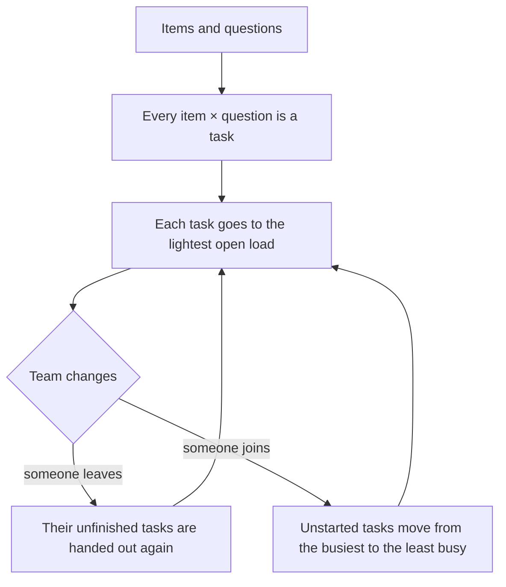

<p>
  <a href="https://github.com/baselnasser99/Data-Tagging-Application/actions/workflows/tests.yml"></a>
  
  
  
  
  <a href="LICENSE"></a>
</p>


**A web app that shares labelling work fairly across a team.** An admin uploads images or audio clips and writes the questions. The app splits the work into tasks and hands them out so everyone carries the same load, even while people join or leave mid-project. The answers come back as a CSV or JSON dataset, with an agreement score showing how consistently people labelled.

Built as my diploma thesis at the University of Pécs, then rebuilt to production standards: security fixes, a fairness algorithm verified with measurements, 300+ automated tests, and a redesigned interface. [See what changed since the graded version →](docs/thesis/COMPARISON.md)

**[What it does](#what-it-does)** · **[How it stays fair](#how-the-hand-out-stays-fair)** · **[Measurements](#measured-not-assumed)** · **[Run it](#run-it)** · **[Docs](#documentation)**

<a href="docs/walkthrough.md#gh-light-mode-only"></a><a href="docs/walkthrough-dark.md#gh-dark-mode-only"></a>
<p align="center"><sub>▶ Click the preview to watch the full walkthrough (75 s)</sub></p>

<table>
  <tr>
    <td width="50%"><b>1 task</b><br><sub>Loads stay within 1 task of each other, even after people join</sub></td>
    <td width="50%"><b>0 lost</b><br><sub>Finished answers lost across 25 benchmark runs</sub></td>
  </tr>
  <tr>
    <td><b>300+ tests</b><br><sub>Automated, ~94% line coverage, on Python 3.11 and 3.12</sub></td>
    <td><b>294 ms</b><br><sub>Median response with 20 people answering at once, 0 errors</sub></td>
  </tr>
</table>


<table>
  <tr>
    <td width="50%"><br><sub><b>Results:</b> agreement per question, answer counts, and where people disagreed</sub></td>
    <td width="50%"><br><sub><b>Project:</b> progress, work balance, questions and settings</sub></td>
  </tr>
  <tr>
    <td><br><sub><b>Member's task:</b> one item, one question, keyboard shortcuts</sub></td>
    <td><br><sub><b>Member's overview:</b> the next task, one click away</sub></td>
  </tr>
  <tr>
    <td><br><sub><b>Hand out tasks:</b> each person's share, shown before anything is handed out</sub></td>
    <td><br><sub><b>People:</b> search, groups, edit and remove</sub></td>
  </tr>
</table>

<sub>Screenshots use the demo data from <code>scripts/seed_demo.py</code>, and follow your GitHub theme: light or dark.</sub>

## What it does

| | |
|---|---|
| **Projects** | Upload images (PNG, JPG, GIF, BMP, WEBP) and audio (MP3, WAV, OGG, M4A, FLAC) as files or ZIPs. Ask free-text or multiple-choice questions about every item. |
| **Fair hand-out** | Every *item × question* becomes a task. Each task goes to the person with the lightest open workload, never twice to the same person, up to a per-person cap. Optionally, several people can answer each task. |
| **People come and go** | When someone leaves a group, their unfinished tasks are handed to the rest; when someone joins, workloads are rebalanced. Finished answers are never lost. |
| **Three roles** | **Admin** (everything), **Manager** (runs their own projects), **Member** (answers their tasks). Each role gets its own home page. |
| **Progress and results** | Status and progress for every project, each person's share of the work, answers per week and progress per group. Each project's results page shows agreement per question (Fleiss' kappa for multiple choice, percent agreement for short free text), how often each answer was given, the items people disagreed on, and the items marked "can't tell". For longer free text it shows the most common words and a few example answers. The side panel lists what needs the admin or manager next. |
| **Export** | CSV or JSON per project, with who answered what and when, the majority answer, **Fleiss' kappa** for inter-annotator agreement, and percent agreement (not chance-corrected) for short free-text answers. Every export is logged. |
| **"Can't tell"** | A member who can't answer an item (blurry, cut off, ambiguous) marks it instead of guessing. It finishes the task, is flagged in the export (`cant_tell`), and is left out of the majority answer and the agreement score. |
| **People admin** | Add people one at a time or from a CSV file, search and filter them, edit details, and remove people safely: their open work is handed on and their answers are kept. |
| **Surveys** | A simpler mode in which every member answers every question. |

## How the hand-out stays fair



```
for each task (item, question) still needing answers:
    candidates = members of the project's groups
                 who don't hold this task yet and are under the per-person cap
    give it to the candidate with the fewest open tasks
        ties → fewest of this question → fewest tasks overall → lowest id
```

- **Someone leaves:** their unfinished tasks are released and handed out again with the same rule; their finished work stays.
- **Someone joins:** open slots are filled first, then unstarted tasks move from the busiest person to the least busy until no move narrows the gap. In the measurements below, loads end within one task of each other.
- **Several groups on one project** share a single pool of tasks.

The code is in [`application/distribution.py`](application/distribution.py), and the rules are pinned down by tests in [`tests/test_distribution.py`](tests/test_distribution.py).

## Measured, not assumed

[`scripts/benchmark.py`](scripts/benchmark.py) builds made-up teams and projects on a **MySQL 8** server in GitHub Actions ([workflow](.github/workflows/benchmark.yml)), then times the real distribution code and checks its fairness. Each setup runs 5 times; cells show the mean, with the fastest and slowest run below it.

| Tasks | People | Setup | Hand out | 10% of people leave | 5% join | Load gap after joining |
|---:|---:|---|---:|---:|---:|---:|
| 1,000 | 20 | 1 group | 0.68 s<br><sub>0.67–0.71</sub> | 0.11 s<br><sub>0.10–0.12</sub> | 0.08 s<br><sub>0.08–0.08</sub> | 1 |
| 10,000 | 50 | 1 group | 7.66 s<br><sub>7.36–8.45</sub> | 2.06 s<br><sub>2.00–2.17</sub> | 1.59 s<br><sub>1.49–1.73</sub> | 1 |
| 50,000 | 100 | 1 group | 43.3 s<br><sub>42.8–43.6</sub> | 19.6 s<br><sub>19.1–19.9</sub> | 20.4 s<br><sub>20.0–20.8</sub> | 1 |
| 10,000 | 50 | 2 answers per task | 11.44 s<br><sub>11.39–11.52</sub> | 2.48 s<br><sub>2.44–2.51</sub> | 2.39 s<br><sub>2.33–2.45</sub> | 1 |
| 10,000 | 50 | 2 groups of 25 | 7.28 s<br><sub>7.21–7.38</sub> | 1.99 s<br><sub>1.92–2.03</sub> | 1.55 s<br><sub>1.48–1.62</sub> | 1 |

- The load gap (most open tasks held by one person minus fewest) is **0** right after hand-out.
- In all 25 runs, every task kept its owners and no finished answer was lost.
- Batching the database writes made the hand-out **2.5× faster**, and handling 5% newcomers at 50k tasks **15× faster** (250 s → 17 s).
- **Load test:** 20 people answering at once made 240 requests with **0 errors**; median response time 294 ms.

## Run it

**Codespaces (no install):** on GitHub, click **Code → Codespaces → Create codespace**, then:

```bash
cp .env.example .env          # set SECRET_KEY, ADMIN_EMAIL and ADMIN_PASSWORD: the example values are refused
pip install -r requirements.txt
flask --app app run --debug
```

<details>
<summary><b>On your own computer</b></summary>

<br>

The same steps, after `python -m venv .venv` and activating it (`source .venv/bin/activate`, or `.venv\Scripts\activate` on Windows). Open http://127.0.0.1:5000 and sign in with the admin email and password from `.env`.

</details>

<details>
<summary><b>With Docker (Flask + MySQL 8)</b></summary>

<br>

`cp .env.example .env`, edit the passwords, then `docker compose up --build`.

The app listens on `127.0.0.1:5000` only, over plain http. Put an HTTPS reverse proxy on the same machine in front of it (for example Caddy: `caddy reverse-proxy --from tagging.example.org --to 127.0.0.1:5000`). Sign-in cookies are sent over HTTPS only, so signing in at `http://` fails on purpose.

</details>

<details>
<summary><b>Try it with demo data</b></summary>

<br>

Fill a separate demo database with 13 people, 3 groups, a manager, two image projects and five weeks of answers:

```bash
export DATABASE_URL=sqlite:///demo.db
python scripts/seed_demo.py
flask --app app run --debug
```

It needs `ADMIN_EMAIL` and `ADMIN_PASSWORD` in `.env`, as above, and prints the demo sign-ins. The demo accounts share a published password, so it only fills a new SQLite database: it refuses one that already has people or projects, and any other kind of database unless you add `--any-database`.

</details>

## Tests

```bash
pip install -r requirements-dev.txt
pytest --cov
```

The tests cover sign-in and access control for each role, CSRF, the distribution rules (joins, leaves, caps, several answers per task), uploads, CSV import, exports and agreement scores, database rules, and the security fixes. GitHub Actions runs them on every push.

<details>
<summary><b>Tracking down a leaked connection or file</b></summary>

<br>

A database connection or file left open makes the tests fail on purpose (see `pytest.ini`). The failure often shows up in whichever test was running when Python cleaned up, not the one that leaked. To see where the leaked object was created, run the tests with allocation tracing (much slower):

```bash
PYTHONTRACEMALLOC=25 pytest --cov
```

On Windows PowerShell, run `$env:PYTHONTRACEMALLOC = "25"` first, then `pytest --cov`.

</details>

## Security

- **Passwords:** hashed with Werkzeug scrypt. There are no default accounts, and secrets live only in `.env`. The app won't start with an example or short `SECRET_KEY` (under 32 characters) or `ADMIN_PASSWORD` (under 8). The graded version's published admin password stops working on upgrade.
- **Passwords set by others:** a password an admin or manager chose for someone must be replaced by its owner at the next sign-in, and a new password must differ from the current one.
- **Sign-in:** it doesn't reveal which emails have accounts: a wrong email and a wrong password take as long and say the same.
- **Wrong passwords:** after 5 for one account from one address, that address pauses for that account for 15 minutes; after 20 from one address across all accounts, the address pauses. A stranger's guesses never lock the owner out. Stored in the database, so it holds across server processes. Behind a reverse proxy, set `TRUSTED_PROXIES` (Docker Compose does), or every visitor shares the proxy's address.
- **Sessions:** removing a person ends every session they had, and a deleted member's old cookie can't open a newly created account.
- **Forms and cookies:** every form has a CSRF token, signing out included, so another site can't sign anyone out. Cookies are HTTP-only, SameSite and sent over HTTPS only (except on the debug server), with an idle timeout. Pages are sent with `Cache-Control: no-store`.
- **Access:** checked on every route. Managers see only their own projects, and members only their own tasks. Uploaded files are served only to the project's people (items by number, so a file name can't give the answer away), and never through the public `/static` route.
- **No outside resources:** pages load nothing from other sites (the fonts are kept in the app), and the Content-Security-Policy allows only this server.
- **Escaping:** all user-written text is escaped, including inside confirm dialogs.
- **Server checks:** everything a form sends is checked on the server: a multiple-choice answer must be one of the options, an answer is at most 5,000 characters, settings and question counts stay within bounds, and two quick submits of one task store one answer.
- **Uploads:** each project may keep at most 2,048 MB of items (`MAX_PROJECT_STORAGE_MB`). ZIPs are unpacked piece by piece, and a failed upload removes what it wrote.
- **Exports:** cells a spreadsheet would run as a formula are neutralised in the CSV.
- **Scripts and Docker:** the scripts ask before deleting a database and don't print its password, and in Docker Compose the app gets only the settings it reads, not the MySQL root password.
- **Logs:** sign-ins, failed sign-ins, sign-outs, account and project changes and exports are written to `logs/audit.log`. Refused requests (a page someone's role may not open, a form without its CSRF token) go to `logs/refused.log` instead: anyone can cause those by the thousand, and in one file they could push the sign-in history out.

## Tech stack

| | |
|---|---|
| **Backend** | Python 3.11 and 3.12, Flask (app factory and blueprints), SQLAlchemy 2, Flask-Login, Flask-WTF (CSRF) |
| **Database** | MySQL 8 in production, SQLite for development and tests; older databases are upgraded automatically on start |
| **Frontend** | Jinja templates, Bootstrap 3 and AdminLTE 2, a custom design layer (`app.css`, `apple.css`) with reduced-motion and high-contrast fallbacks, Chart.js |
| **Quality** | pytest with ~94% line coverage on Python 3.11 and 3.12, GitHub Actions, Dependabot |
| **Deployment** | Docker Compose (Gunicorn and MySQL) |

<details>
<summary><b>Project layout</b></summary>

```
application/
├── auth.py              sign-in, sign-out, sessions
├── admin.py             dashboard, people, CSV import, surveys, downloads
├── groups.py            groups and their members
├── manager.py           managers and their pages
├── annotation_admin.py  projects: create, upload (files, ZIPs, storage limit), hand out, progress, export
├── annotation.py        members' tasks and answers
├── distribution.py      the fair hand-out algorithm
├── uploads.py           where uploaded files live, survey attachments
├── surveys.py           handing out survey questions
├── export.py            CSV/JSON export and agreement scores
└── permissions.py, models.py, templates/, static/
```

</details>

## Documentation

- [Technical documentation](docs/thesis/updated/DOCUMENTATION.md): architecture, data model, algorithm, export, security, evaluation and limitations
- [Original vs. updated](docs/thesis/COMPARISON.md): what the graded thesis claimed, what the code did then, and what is true now
- [Defence presentation](docs/thesis/updated/DEFENSE_PRESENTATION.md) and [defence Q&A](docs/thesis/updated/DEFENSE_FAQ.md)
- The code as graded: tag [`v1.0-thesis-submitted`](https://github.com/baselnasser99/Data-Tagging-Application/tree/v1.0-thesis-submitted)
- [Thesis (revised 2026, PDF), describes release v3.0](https://github.com/baselnasser99/Data-Tagging-Application/releases/tag/v3.0)

## License

[MIT](LICENSE)
